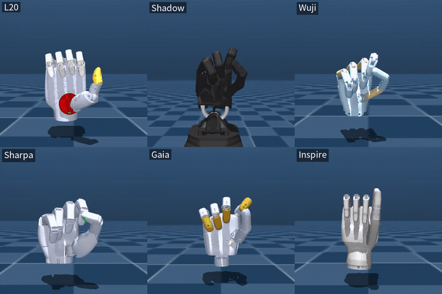

# MB-ADR

[中文](README.zh.md) | English

**M**odel-**B**ased **A**ny**D**ex**R**etargeting.

End-to-end, **model-based** neural retargeting for dexterous robot hands.

Replaces a per-frame NLopt solve with a learned network, while keeping the
optimiser's objective and the robot's kinematics as the source of truth.

This repository is self-contained: it ships its own hand definitions, URDF and
MuJoCo assets, retargeting configs, NLopt reference solver, differentiable FK,
and the Pico 4 input driver. Nothing outside the repo is imported, and the only
external dependencies are ordinary libraries (numpy, torch, nlopt, mujoco,
pinocchio, scipy).



*l20, Shadow, Wuji, Sharpa, Gaia, Inspire — same input, each hand's own
network, same scene (background and palm-forward orientation unified in
`mbadr/scene.py`).*

## What "model-based" means here

The supervision is an **analytic differentiable forward-kinematics model**, not
a learned surrogate and not joint labels:

```
human keypoints ──► adaptive targets ──► loss ◄── analytic FK ◄── network output
                        (numpy-free)      │
                                          └─── gradients via autograd
```

Three consequences of that choice, each of which matters for fingertip accuracy:

| | learned-FK approaches | this |
|---|---|---|
| FK used in training | MLP surrogate fitted to sampled poses | exact URDF chain, matches Pinocchio to 1e-16 m |
| mimic joints | predicted as independent DOF, corrected post hoc | expanded inside FK, always consistent |
| joints the network predicts | all nq, including dependent ones | only the independent DOF |

The difference is not cosmetic. If a network predicts the distal joints and they
are afterwards overwritten from the PIPs, the fingertip moves to a place the
network never optimised for. Predicting only the independent DOF removes that
failure mode by construction, since the FK caches the coupling and the loss sees
the position the hardware will actually reach.

## Supported hands

| `--robot` | nq | independent DOF | mimic | note |
|---|---|---|---|---|
| `l20` | 21 | 16 | 5 | DexForce Linker L20 |
| `shadow` | 22 | 22 | — | Shadow Hand |
| `wuji` | 20 | 20 | — | Wuji Hand |
| `sharpa` | 22 | 22 | — | Sharpa Wave |
| `gaia` | 20 | 16 | 4 | Gaia Hand20 |
| `inspire` | 12 | 6 | 6 | Inspire Hand, most under-actuated |

Hand definitions live in `mbadr/robot_configs.py` with their assets under
`assets/` and their configs under `configs/pico4/`. Adding a hand means adding
an entry there plus its URDF/MJCF; the FK, loss, training and evaluation code is
hand-agnostic. Left/right link naming conventions are mirrored per manufacturer
(`rh_`→`lh_`, `right_`→`left_`).

## Layout

```
mbadr/
  chain.py             URDF -> flat kinematic description, mimic bookkeeping
  config.py            HandSpec: per-hand links/offsets/URDF/MJCF resolution
  robot_configs.py     the hand table (links, offsets, asset paths)
  mediapipe.py         landmark frame conversion (wrist frame -> MANO)
  fk_numpy.py          NumPy FK + analytic Jacobians
  fk_torch.py          batched differentiable FK, mimic expansion as a linear map
  reference.py         NumPy + NLopt reference solver (the "ground truth")
  loss_torch.py        the same objective in Torch, for training
  data.py              loading, dedup, anatomically-checked augmentation
  model.py             amortising MLP, joint limits as a hard constraint
  mjcf.py              URDF joint order <-> MuJoCo qpos mapping
  scene.py             shared viewing scene: background, upright palm-forward pose
  pico4.py             Pico 4 input driver (relay / direct)
  train.py             self-supervised training loop
  evaluate.py          net vs NLopt on identical keypoints
scripts/
  verify_fk.py         NumPy FK/Jacobian vs Pinocchio
  verify_fk_torch.py   Torch FK vs Pinocchio (forward, autograd Jacobian, CUDA)
  verify_loss.py       Torch loss vs NumPy reference (values and gradients)
  demo_mujoco.py       replay a recording through the net in MuJoCo
  demo_pico4.py        live Pico 4 input -> net -> MuJoCo
  check_nlopt_budget.py  is the net's advantage real or NLopt under-converged?
  summarise.py         aggregate per-hand evaluation results
assets/                URDF / MJCF / meshes for the six hands
configs/pico4/         retargeting YAML per hand
data/                  keypoint dataset (.npy) and recordings/ (.pkl, for demos)
out/                   checkpoints and evaluation JSON
```

## Verification

Two independent implementations of the objective (Torch and NumPy) are checked
against each other, and the kinematics is checked against Pinocchio. The checks
are not decorative — four real bugs were found this way:

1. mimic clipping semantics (`index_pip` max × 0.89 overshoots `index_dip` max);
2. matrix order in the Torch FK (URDF applies joint rotation on the right);
3. joint-order conversion between URDF and Pinocchio orderings;
4. `AdaptiveParams` defaults copied from L20's YAML instead of the reference's
   own defaults — invisible while only L20 was supported, because its config
   writes every key explicitly.

```bash
python scripts/verify_fk.py --robot all       # positions to 1e-16 m, Jacobians to 1e-10
python scripts/verify_fk_torch.py             # forward 3.7e-8 m (f32), Jacobian 9.7e-17
python scripts/verify_loss.py --robot all     # loss 2.3e-13, gradient 5.5e-8
```

## Train

```bash
python -m mbadr.train --robot shadow --data-npy data/qsq_pico4_merged_v1.npy \
    --steps 12000 --out out/net_shadow.pt
```

Training needs only keypoints; no joint labels are collected or used. With
`--data-npy` the last 15 % of the capture is held out by time, so validation is
contiguous with, but disjoint from, training.

## Evaluate

```bash
python -m mbadr.evaluate --robot shadow --checkpoint out/net_shadow.pt \
    --data-npy data/qsq_pico4_merged_v1.npy
python scripts/summarise.py
```

Frames are stratified by pinch coverage: pinch appears in roughly a third of
real frames but in contiguous runs, so a naive first-N slice can contain none of
it and silently leave the metric that matters most unmeasured.

## Visualise

```bash
# recorded replay, no hardware needed
python scripts/demo_mujoco.py --robot shadow --recording pico4_check.pkl

# live Pico 4 (relay daemon on 127.0.0.1:63902, or --mode direct)
python scripts/demo_pico4.py --robot l20 --hand right
```

## Environment

```bash
conda env create -f environment.yml      # python 3.10 + numpy/scipy/pinocchio/mujoco
conda activate mbadr
pip install torch --index-url https://download.pytorch.org/whl/cu121   # match your driver
pip install nlopt
```

Everything the project needs is in this repository: hand definitions, URDF and
MuJoCo assets, retargeting configs and keypoint recordings.
