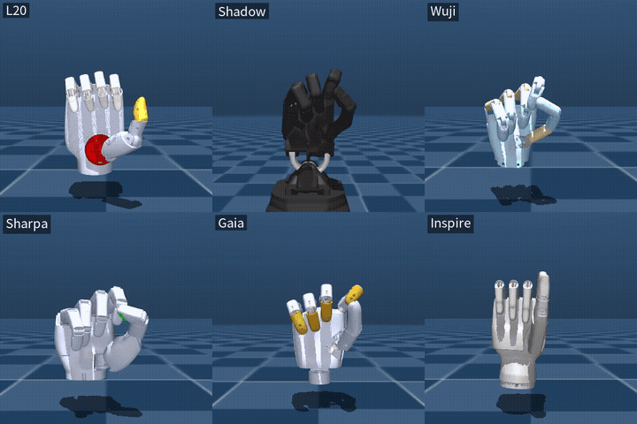

# MB-ADR

中文 | [English](README.md)

**M**odel-**B**ased **A**ny**D**ex**R**etargeting。

面向多种灵巧手的端到端、**model-based** 神经网络 retargeting 方案。

用一个学习出来的网络替代逐帧 NLopt 求解，同时保持优化器的目标函数和机器人运动学作为唯一的真值来源。

PC 端代码与资产自包含：自带手型定义、URDF/MJCF、retargeting 配置、NLopt 参考求解器、可微 FK、Pico 4 接收驱动和 L20 RS485 真机驱动。运行时无需导入其他项目或厂商 SDK；Python 依赖见 `environment.yml` 和 `requirements.txt`。Pico 头显端使用 XR-Robotics/XRoboToolkit，需另行安装 APK；PC relay 已包含在本项目中。



*l20、Shadow、Wuji、Sharpa、Gaia、Inspire —— 同一份输入，每只手各自的网络，同一套场景（背景与掌心朝向在 `mbadr/scene.py` 中统一处理）。*

## 快速开始

以下命令在**完整仓库根目录**执行，先按[环境搭建](#环境搭建)安装并激活 Python 环境。
仓库已包含六只手的 checkpoint，回放、实时推理和 L20 真机控制无需先训练。

| 目标 | 入口 | 额外前提 |
|---|---|---|
| 离线录像回放 | `scripts/demo_mujoco.py` | 可创建 OpenGL 窗口的桌面环境 |
| Pico 实时仿真 | `scripts/demo_pico4.py` | Pico 数据发送应用、网络连接、OpenGL 窗口 |
| Pico 驱动 L20 真机 | `scripts/teleop_l20.py` | Pico 数据发送应用、L20 V10 RS485 连接；无需窗口 |

```bash

# 离线回放：不需要 Pico 或真机
python scripts/demo_mujoco.py --robot l20 --hand right --device cpu \
    --recording pico4_check.pkl --loop

# 实时仿真：先准备下文的 Pico 数据连接
python scripts/demo_pico4.py --robot l20 --hand right --device cpu

# 验证真机指令映射：只打印寄存器，不打开串口
python scripts/teleop_l20.py --hand right --device cpu --dry-run
```

继续阅读：[Pico 数据连接](#pico-4-数据连接) · [L20 真机](#l20-真机pico-4--rs485) ·
[平滑与日志](#平滑与运行状态) · [常见问题](#常见问题) · [训练](#训练) · [评估](#评估)。
仿真关闭窗口退出，真机入口按 Ctrl+C 退出。

## 环境搭建

版本 `0.1.0b1` 为 Beta 候选。推荐从完整 Git 检出安装，CPU 复现步骤如下：

```bash
git clone https://github.com/qqsq12321/MB-ADR.git
cd MB-ADR
python3.10 -m venv .venv
source .venv/bin/activate
python -m pip install --upgrade pip
python -m pip install torch==2.5.1 --index-url https://download.pytorch.org/whl/cpu
python -m pip install -e '.[all]' -c constraints/py310-torch25.txt
python -m pip check
```

已有 Conda `mbadr` 环境可直接激活，然后执行上面的 editable 安装命令。
新建 Conda 环境仍可使用 `conda env create -f environment.yml`；PyTorch 单独安装。
CUDA 12.1 构建可将上面的 CPU 安装命令替换为：

```bash
python -m pip install torch==2.5.1 --index-url https://download.pytorch.org/whl/cu121
```

依赖统一定义在 `pyproject.toml`：基础推理/训练为核心依赖，`simulation`、`hardware`、
`verification`、`dev` 为可选组，`all` 安装全部。Pinocchio 的 PyPI 包名为 `pin`。
两组 CPU 约束为 `constraints/py310-torch25.txt` 与 `constraints/py310-torch26.txt`，
分别对应 PyTorch 2.5.1 和 2.6.0；它们约束已测的直接依赖，不是完整传递依赖锁文件。
安装方式见 [PyTorch 官方历史版本](https://docs.pytorch.org/get-started/previous-versions/)。

安装后可使用 `mbadr-train`、`mbadr-evaluate`、`mbadr-l20` 和 `mbadr-pico-relay`。
wheel 只包含代码与声明，不携带手模型、录像和权重；使用非 editable 安装时，设置
`MBADR_PROJECT_ROOT` 为包含 `assets/configs/data/out` 的完整检出目录。
仓库自带 checkpoint 已转为张量和基础元数据格式，推理显式使用 `weights_only=True`；
旧文件迁移说明见 [checkpoint 说明](out/README.md)。

## "model-based" 在这里指什么

监督信号来自一个**解析的、可微的正运动学（FK）模型**，而不是学出来的 FK 代理，也不是关节角标签：

```
人手关键点 ──► 自适应目标 ──► loss ◄── 解析 FK ◄── 网络输出
                  (Torch)        │
                                 └─── 梯度来自 autograd
```

这个选择带来三个直接后果，每一个都关系到指尖精度：

| | 学习 FK 代理的方案 | 本项目 |
|---|---|---|
| 训练时用的 FK | 对采样姿态拟合出的 MLP 代理 | 精确的 URDF 运动学链，与 Pinocchio 对齐到 1e-16 m |
| mimic 关节 | 当作独立自由度预测，之后再做修正 | 在 FK 内部展开，始终保持一致 |
| 网络预测的关节 | 全部 nq 个，包括从属关节 | 仅独立自由度 |

这个差异不是表面上的。如果网络预测了远端关节、之后又被 PIP 关节的值覆盖，指尖就会落到网络从未优化过的位置。只预测独立自由度从结构上消除了这个失败模式，因为关节耦合关系被固化在 FK 里，loss 看到的姿态与该联动模型一致。真机的零位、驱动指令和实际误差仍需通过硬件映射与联调校准。

## 支持的手型

| `--robot` | nq | 独立自由度 | mimic | 备注 |
|---|---|---|---|---|
| `l20` | 21 | 16 | 5 | DexForce Linker L20 |
| `shadow` | 22 | 22 | — | Shadow Hand |
| `wuji` | 20 | 20 | — | Wuji Hand |
| `sharpa` | 22 | 22 | — | Sharpa Wave |
| `gaia` | 20 | 16 | 4 | Gaia Hand20 |
| `inspire` | 12 | 6 | 6 | Inspire Hand，欠驱动程度最高 |

手型定义在 `mbadr/robot_configs.py`，资产放在 `assets/`，配置放在 `configs/pico4/`。新增手型需准备模型、定义任务点、配置尺度与坐标标定，并训练对应权重；FK、loss、训练和评估共用现有实现。

表中六只手均具备配置、资产与 `out/net_<robot>.pt`；当前自带 checkpoint 均标注为右手。
真机输出目前只实现 L20 RS485，其他手型支持训练、评估和仿真。
仿真示例建议使用表中的短名称：默认 checkpoint 文件名直接使用 `--robot` 的字面值。

## 扩展项目

- [新增灵巧手](docs/ADDING_HAND.zh.md)：准备 URDF/MJCF、注册手型、设置任务点与 mimic、标定 YAML、训练及仿真。
- [接入其他输入源](docs/INPUT_SOURCES.zh.md)：21 点数据约定、单位与坐标系转换、推理 API、新鲜度处理及自定义数据训练。

现有实时命令使用 Pico；其他输入源通过 Python API 接入。新增手型的真机控制需要实现对应的输出驱动。

训练、评估、录像回放、Pico 仿真和 L20 实时命令均可通过 `--config 路径` 选择标定 YAML；
Python 推理接口使用 `KeypointRetargeter(..., config_path=Path(...))`。
省略时使用所选手型的 Pico 配置。训练、推理及评估应使用同一份配置。

## 目录结构

```
mbadr/
  chain.py             URDF -> 扁平化运动学链描述，mimic 关节记录
  config.py            HandSpec：每只手的 link/偏移/URDF/MJCF 解析
  robot_configs.py     手型表（link 名、偏移、资产路径）
  mediapipe.py         关键点坐标系转换（手腕坐标系 -> MANO）
  fk_numpy.py          NumPy FK + 解析 Jacobian
  fk_torch.py          批量化可微 FK，mimic 展开实现为线性映射
  reference.py         NumPy + NLopt 参考求解器（"标准答案"）
  loss_torch.py         同一个目标函数的 Torch 版本，用于训练
  data.py              数据加载、去重、带解剖学检查的数据增强
  model.py             做摊销推理的 MLP，关节限位作为硬约束
  mjcf.py              URDF 关节顺序 <-> MuJoCo qpos 的映射
  scene.py             统一的可视化场景：背景、手指朝上掌心朝前的姿态
  pico4.py             Pico 4 输入驱动（relay / direct）
  live.py              无窗口的实时网络推理（URDF 关节顺序）
  checkpoint.py        张量格式 checkpoint 的受限加载
  pico_relay.py        XRoboToolkit 发现、接收和本地 relay
  l20.py               L20 真机 RS485/Modbus 协议与校准映射
  train.py             自监督训练循环
  evaluate.py          在相同关键点上对比网络与 NLopt
scripts/
  verify_fk.py         NumPy FK/Jacobian 对照 Pinocchio
  verify_fk_torch.py   Torch FK 对照 Pinocchio（前向、autograd Jacobian、CUDA）
  verify_loss.py       Torch loss 对照 NumPy 参考实现（数值与梯度）
  demo_mujoco.py       用网络回放一段录像，在 MuJoCo 中展示
  demo_pico4.py        Pico 4 实时输入 -> 网络 -> MuJoCo
  teleop_l20.py        Pico 4 实时输入 -> 网络 -> L20 真机（无窗口）
  check_nlopt_budget.py  网络的优势是真实的，还是 NLopt 没收敛到位？
  summarise.py         汇总各手型的评估结果
assets/                六只手的 URDF / MJCF / mesh
configs/pico4/         每只手的 retargeting YAML
data/                  关键点数据集（.npy）以及 recordings/（.pkl，供 demo 使用）
out/                   checkpoint 与评估结果 JSON
tests/                 校准映射、Modbus、Pico 数据有效性与完整 dry-run 测试
```

## 训练

```bash
python -m mbadr.train --robot l20 --data-npy data/qsq_pico4_merged_v1.npy \
    --steps 12000 --out out/net_l20_custom.pt
```

训练只需要关键点数据，不收集也不使用任何关节角标签。使用 `--data-npy` 时，会按时间顺序留出采集数据最后 15% 作为验证集，因此验证集与训练集在时间上相邻但互不重叠。

训练输入为单位米的原始 `(N, 21, 3)` 关键点；加载器会执行与实时输入相同的预处理。
训练默认输出为 `out/net.pt`，示例显式另存为 `net_l20_custom.pt`，避免覆盖自带模型。
使用自训模型运行演示或真机时，传入对应的 `--checkpoint`。

## 评估

```bash
python -m mbadr.evaluate --robot l20 --checkpoint out/net_l20.pt \
    --data-npy data/qsq_pico4_merged_v1.npy --out out/eval_l20.json
python scripts/summarise.py
```

评估帧按 pinch 覆盖率做分层抽样：真实数据里大约三分之一的帧存在 pinch，但往往连续成段出现，直接取前 N 帧很可能一个 pinch 帧都抽不到，从而悄悄漏掉最关键的那项指标。

评估自训模型时替换 `--checkpoint`。汇总脚本读取 `out/eval_<robot>.json`，因此示例
显式指定 `--out`；评估模块自身的默认输出是 `out/eval.json`。

## 可视化

```bash
# 用录像回放，不需要硬件
python scripts/demo_mujoco.py --robot shadow --recording pico4_check.pkl

# Pico 4 实时输入（relay 守护进程监听 127.0.0.1:63902，或使用 --mode direct）
python scripts/demo_pico4.py --robot l20 --hand right
```

## Pico 4 数据连接

头显发送端为 **XR-Robotics / XRoboToolkit**。官方
[v1.1.1 APK](https://github.com/XR-Robotics/XRoboToolkit-Unity-Client/releases/download/v1.1.1/XRoboToolkit-PICO-1.1.1.apk)、
[其他版本](https://github.com/XR-Robotics/XRoboToolkit-Unity-Client/releases)及详细步骤见
[Pico 安装与协议说明](docs/PICO_SETUP.md)。当前维护者实际安装的 APK 版本尚未记录。
Pico 和 PC 需网络互通；在头显应用中选择 PC 地址，开启 **Tracking — Hand** 和 **Send**。

```bash
# 终端 1：本项目自带 relay，持续运行
python scripts/pico4_daemon.py

# 终端 2：使用默认 relay 模式
python scripts/demo_pico4.py --robot l20 --hand right --device cpu
```

| 模式 | PC 行为 | 默认端口 | 使用条件 |
|---|---|---|---|
| `relay`（默认） | 应用连接本项目或已有的兼容 relay | `127.0.0.1:63902/TCP` | 先启动 relay，重启应用不必重连头显 |
| `direct` | 应用自行监听头显并广播 PC IP | `63901/TCP`、`29888/UDP` | 不运行 relay，仅启动一个接收应用 |

```bash
# 也可不运行 relay，使用单个应用的直连接收器
python scripts/demo_pico4.py --robot l20 --hand right --mode direct --device cpu
```

真机入口同样支持 `--mode direct`。relay 的头显接入端与 direct 默认都使用 TCP 63901，
不要让它们或上游 PC-Service 同时占用该端口。远程 relay 使用 `--relay-host`、`--relay-port`；
直连端口可通过 `--port`、`--broadcast-port` 调整，需与头显端配置一致。
接收器读取 `Hand.leftHand/rightHand` 的 `isActive` 和 26 个 `HandJointLocations`，
每个 `p` 为逗号分隔的位姿字符串，取前三项转换为手腕居中的 21 点、单位米。
普通投屏或仅开启系统手部追踪不会自动发送这条数据流。

## L20 真机（Pico 4 + RS485）

使用本项目的 `out/net_l20.pt`，不需要 AnyDexRetarget、厂商 SDK 或 MuJoCo
窗口。串口默认 `/dev/ttyUSB0`、460800 baud、8N1，右手从站 `0x29`、左手
`0x2A`。这套协议和校准映射以 L20 V10 RS485 驱动为基准；CAN 连接不走此入口。
已有环境需先安装 `python -m pip install pyserial`。Pico 端需要运行兼容的数据发送应用；
relay 模式连接本项目或已有的 `127.0.0.1:63902` 服务。

```text
Pico 骨骼点 → 统一预处理 → MLP → 16 个独立关节平滑
  → 展开 5 个联动关节 → 按关节名做校准映射 → 30 个位置寄存器 → RS485
```

驱动位于 `mbadr/l20.py`，包含关节方向、零位偏移、拇指分段校准和 Modbus CRC/回包校验。
该链路发送位置目标，不读取真机编码器或力反馈。

```bash
conda activate mbadr

# 只计算并打印 30 个位置寄存器，不打开串口
python scripts/teleop_l20.py --hand right --device cpu --dry-run --duration 10

# 真机：打开 RS485，Pico 手势驱动 L20
python scripts/teleop_l20.py --hand right --device cpu \
    --l20-port /dev/ttyUSB0 --l20-baudrate 460800 --l20-slave-id 0x29
```

实际端口和从站地址应与手的配置一致；串口也可使用 `/dev/serial/by-id/` 下的稳定路径。

| 参数 | 默认值 | 含义 |
|---|---|---|
| `--checkpoint` | 仓库内 `out/net_l20.pt` | 本项目训练的 L20 网络 |
| `--smooth` | `0.3` | 独立关节上的 EMA 平滑系数 |
| `--l20-speed` / `--l20-current-limit` | 均为 `200` | 设备寄存器值，范围 0–255，不是物理单位 |
| `--hz` | `60` | 处理新样本和发送命令的最高频率 |
| `--input-timeout` | `0.5` 秒 | 选定手的接收数据超时后暂停更新目标 |
| `--duration` | `0` | 运行时长，0 表示持续运行 |
| `--dry-run` | 关闭 | 仅计算和打印寄存器，不打开串口 |
| `--l20-print-registers` | 关闭 | 打印实际命令值 |
| `--l20-open-on-exit` | 关闭 | 开启后在退出时发送张手命令 |
| `--l20-clear-faults` | 关闭 | 开启后在启动时清故障寄存器 |

去掉 `--device cpu` 会在 CUDA 可用时自动选择 GPU。

追踪无效、断开或超过 `--input-timeout 0.5` 秒未更新时，停止更新目标，设备保持
上次的目标；恢复追踪后继续。这是暂停目标更新，不是硬件急停。Ctrl+C 关闭连接，默认不额外发送姿态；显式添加
`--l20-open-on-exit` 才在退出时发送张手命令。清故障需显式添加 `--l20-clear-faults`。
当前自带 checkpoint 标注为右手，左手需传入匹配的 `--checkpoint`，入口会检查手侧。
启动时会配置速度和电流限制，运行时应只有一个程序占用对应串口。
硬件无关测试覆盖协议、映射和虚拟串口，但不代替实际设备联调。

硬件无关的验证（校准映射、Modbus 报文/回包、Pico 超时和完整 dry-run 链路）：

```bash
python -m unittest discover -s tests -v
```

## 平滑与运行状态

两个实时入口均默认 `--smooth 0.3`。在 **0 到 1 之间**，数值越小越平滑、延迟越大；
`0` 是特殊值，表示关闭平滑。静止时小幅抖动可试 `--smooth 0.1`，更跟手可试 `0.5`。
YAML 中的 `lp_alpha` 不控制这两个脚本的平滑，实际使用 CLI 的 `--smooth`。

| 入口 | 平滑位置与更新方式 | 日志含义 |
|---|---|---|
| `demo_pico4.py` | 展开并映射后的 MuJoCo 关节，每个窗口循环更新 | `applied ... fps` 是应用缓存姿态的频率，不是 Pico 采样率 |
| `teleop_l20.py` | 独立关节上平滑，每个新的有效 Pico 样本最多更新一次 | `input ... fps` 是处理频率；`commands ... Hz` 是寄存器变化的输出频率 |

因此同一平滑参数在两个入口的手感可能不同。手不动时 `commands` 为 0 可以是重复指令
被省略，不等于连接中断。完整选项可通过各入口的 `--help` 查看。

## 常见问题

| 现象 | 排查方式 |
|---|---|
| `No module named torch` 或 `serial` | 激活 `mbadr`，用 `which python` 确认解释器；串口依赖安装到同一个环境 |
| `checkpoint not found` | 在仓库根目录运行；仿真默认相对路径 `out/net_<robot>.pt`，也可显式传 `--checkpoint` |
| 一直等待追踪、`input 0.0 fps` | 确认头显应用在发送选定手的数据；端口监听只说明服务启动，不保证收到骨骼帧 |
| `Address already in use` | TCP 63901 可能被 relay 或另一个 direct 实例占用，改用 relay 或关闭重复实例 |
| 串口不存在、权限不足或被占用 | 查看 `/dev/serial/by-id/` 和串口权限，确认用户有串口访问权限且没有其他控制程序 |
| Modbus 超时、CRC 或回包错误 | 核对电源、RS485 接线、波特率和实际从站地址；传输校验失败会中止发送并关闭连接 |
| `Checkpoint was trained for right; requested left` | 使用与手侧匹配的 checkpoint；仅改 `--hand` 不会把右手模型转换为左手模型 |
| checkpoint 含旧 NumPy 元数据、无法安全加载 | 自带模型已迁移；自训旧文件按 [迁移说明](out/README.md) 转换，正常推理不会自动启用不受限 pickle |

`GLX: Failed to create context` / `could not create window` 属于仿真窗口的 OpenGL 问题。
可先使用 Mesa 软件渲染（需系统已有 Mesa；本机已验证）：

```bash
__GLX_VENDOR_LIBRARY_NAME=mesa LIBGL_ALWAYS_SOFTWARE=1 \
python scripts/demo_pico4.py --robot l20 --hand right --device cpu
```

仅加 `--device cpu` 不会切换窗口渲染器。若 `nvidia-smi` 报 `Driver/library version mismatch`，
应处理内核驱动与用户态库不一致，参见 [Ubuntu 官方说明](https://ubuntu.com/server/docs/how-to/graphics/install-nvidia-drivers/#driverlibrary-version-mismatch-error)。
真机入口不创建 OpenGL 窗口，不需要设置上述 Mesa 变量。

## 参与贡献与发布状态

安装、测试与贡献流程见 [CONTRIBUTING.md](CONTRIBUTING.md)，版本变化见
[CHANGELOG.md](CHANGELOG.md)。CI 覆盖 Python 3.10 与两个 PyTorch CPU 版本；
本地实测与远端 CI 结果的区别记录在 [验证报告](docs/VALIDATION.md)。
L20 实物控制维持实验性，状态与实测记录模板见 [硬件验证](docs/HARDWARE_VALIDATION.md)。

自有代码、配置、数据和训练权重采用 [MIT](LICENSE)，第三方模型保留各自条款，
见 [第三方声明](THIRD_PARTY_NOTICES.md)。模型与数据的字节校验清单位于
[artifacts/manifest.json](artifacts/manifest.json)。发布步骤见 [RELEASING.md](docs/RELEASING.md)，
引用信息见 [CITATION.cff](CITATION.cff)。
